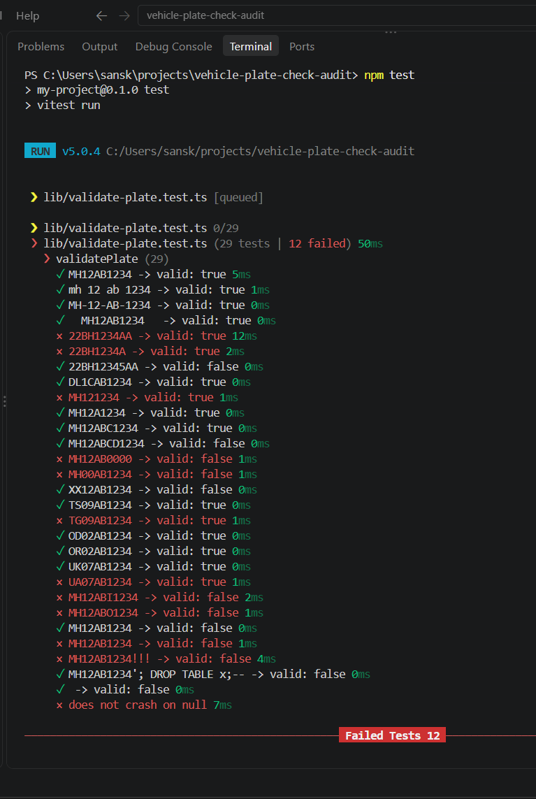
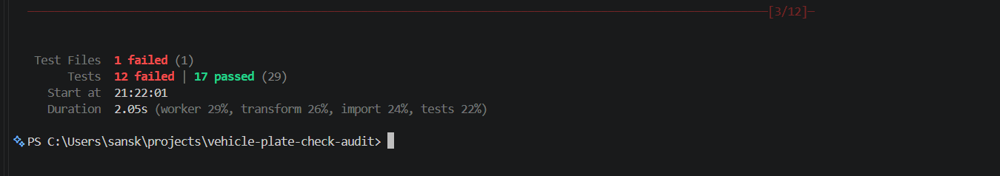
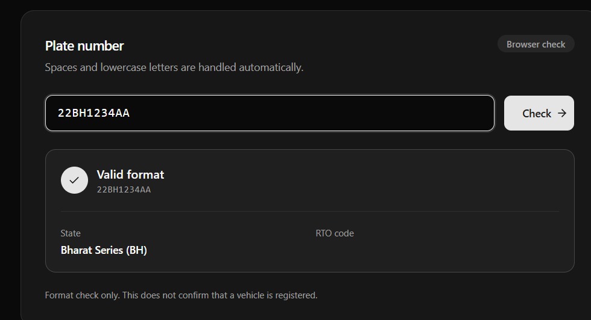
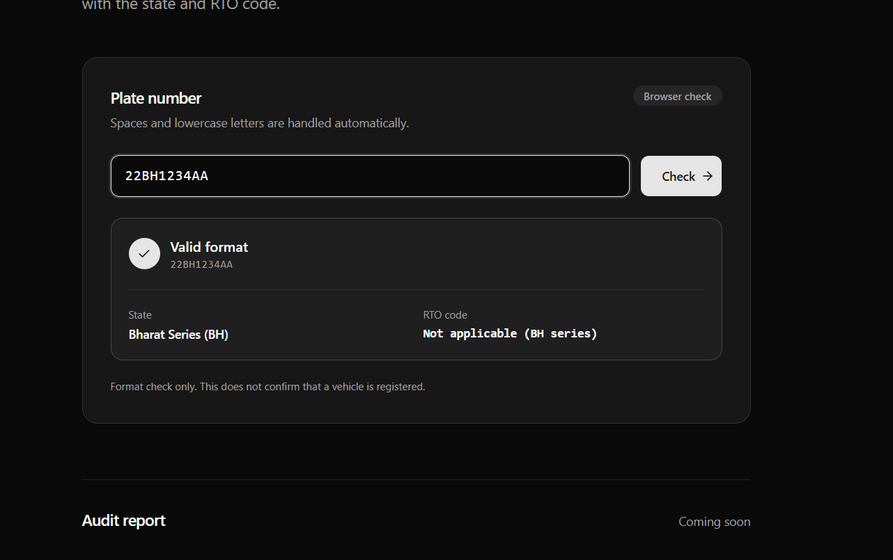
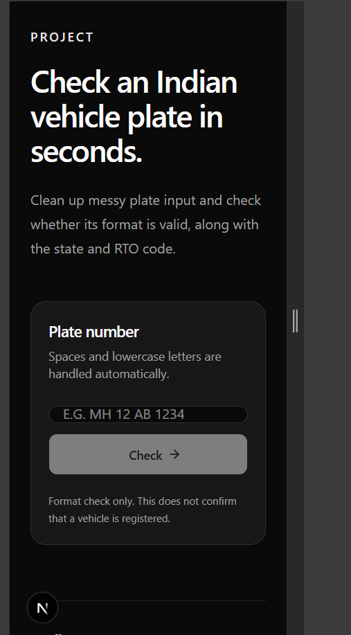
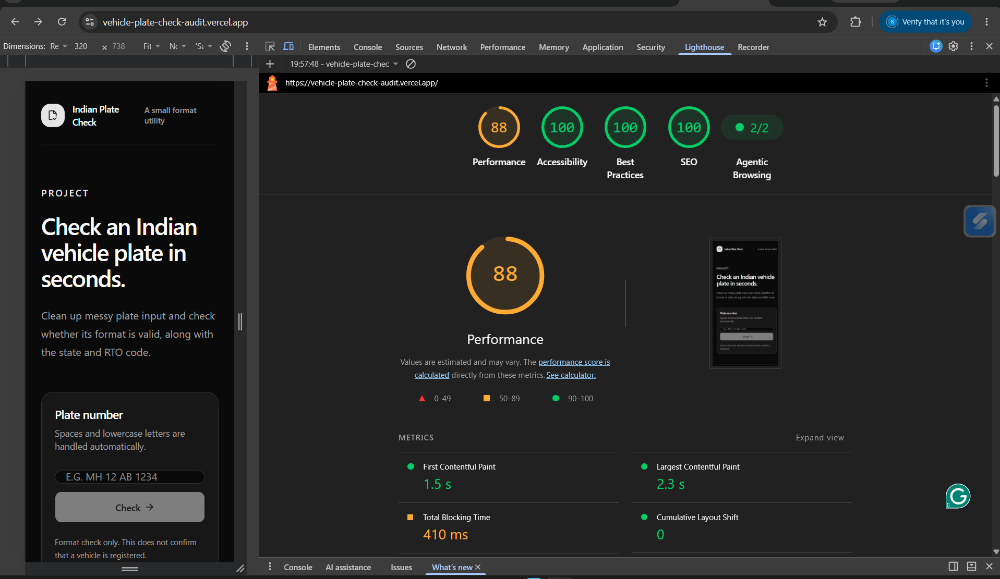
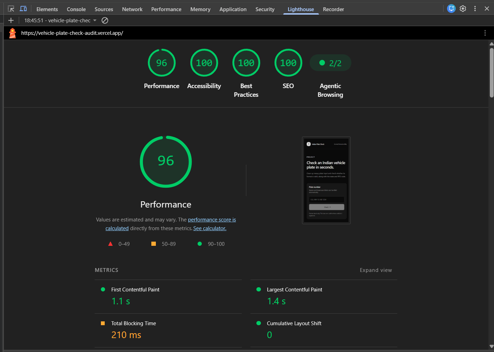

# Indian Plate Check: a vibe-code audit

**AI generated this app in about a minute. I tested it, found 12 failing cases, and fixed them one commit at a time.**

[Live site](https://vehicle-plate-check-audit.vercel.app/) · [Test cases](lib/validate-plate.test.ts) · [Commit history](https://github.com/Sanskrutiraka/vehicle-plate-check-audit/commits/main)

What this shows: I don't treat AI output as finished work. I measure it, check domain rules against sources, fix bugs in small reviewable commits, and report my own mistakes too.

## Result

| | Before | After |
|---|---|---|
| Passing tests | 17 of 29 | 31 of 31 |
| Failing tests | 12 | 0 |

(The after count includes two tests I added for RTO codes.)

Lighthouse scored accessibility and best practices at 100 both before and after, and it never saw the validator bugs. Automated scores can't tell you whether `22BH1234AA` is handled correctly. Tests can.

## How I worked

v0 generated the app. I used an AI assistant (Claude) to plan the test cases and talk through fixes. I ran every test, checked the plate rules against sources, and made each change and commit myself. One assumption in my test plan turned out to be wrong when I checked sources (see the Delhi example below).

## How I review AI-generated code

1. Write tests from the domain rules before reading the generated code.
2. Run them and record the failures untouched. That's the baseline.
3. If I'm unsure of a rule, check a source before changing any code.
4. One fix per commit, tests re-run each time.
5. Don't trust automated scores alone. Lighthouse said 100 while the logic had 12 bugs.

## What went wrong

- Unknown characters were silently deleted, so bad input counted as valid
- BH-series plates rejected
- Old plates without series letters rejected
- RTO code `00` and number `0000` accepted
- New Telangana code `TG` and legacy Uttarakhand code `UA` missing
- Letters `I` and `O` accepted in the series
- Crash on `null` input
- UI showed a blank RTO code for BH plates
- Input collapsed to a thin bar on phone-width screens

The full table, with examples and fixes, is on the live site. Every fix is its own commit, so the history reads as the audit.

## What went right

The validator was a separate pure function (easy to test), state codes lived in a lookup table, the input had a proper label, and the result was announced to screen readers.

## Mistakes of my own

- I expected the Delhi plate `DL1CAB1234` to have RTO code `1C`. Checking sources showed the RTO is `1` and the `C` belongs to the series, so the validator was right and my test was wrong. I corrected the test.
- I installed the test tool with npm in a pnpm project, which left the lockfile out of date and made every Vercel build fail until I fixed it.

## Evidence

| | |
|---|---|
| Baseline test run |  |
| Baseline summary |  |
| BH plate, blank RTO (before) |  |
| BH plate, fixed |  |
| Mobile input bug |  |
| Lighthouse (before) |  |
| Lighthouse (after) |  |

## A note on sources

Plate rules were checked against secondary sources (news reports on the Telangana change, reference pages on series letters and legacy codes), not an official transport-ministry table. Two rules, RTO `00` and number `0000` being invalid, are design choices I made, not verified official rules.

## Known gaps

Andaman and Nicobar (`AN`) and the legacy `DN` code are not in the state list yet. This tool checks format only. It does not confirm that a vehicle is registered.

## Run it

```
pnpm install
pnpm dev
pnpm test
```

## Stack

Next.js, TypeScript, Vitest, pnpm. Generated with v0, deployed on Vercel.